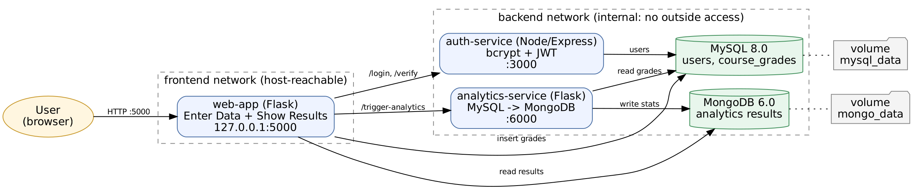
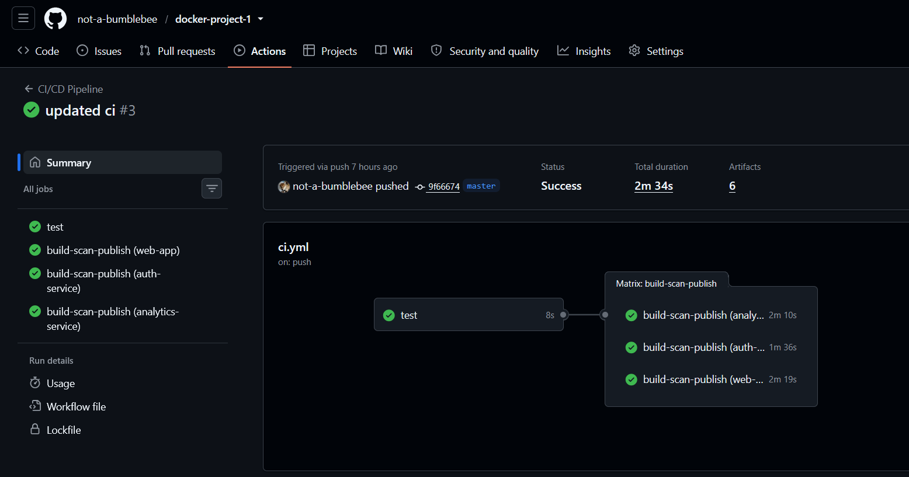
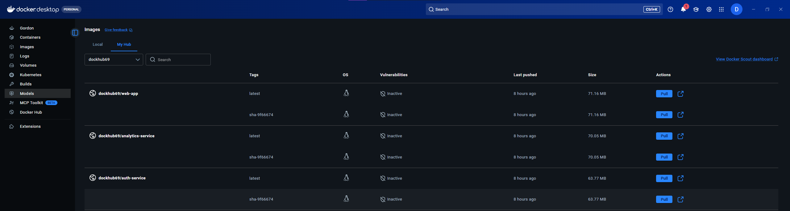

# Technical Report: Containerized Data Collection and Analytics System

**CIT3495 Project 1, Group 13 (Nicholas)**

## 1. Overview

We built the Data Collection and Analytics System (Option 1) as five containers: a web app (Enter Data and Show Results in one container, approved by the instructor), an authentication service, an analytics service, MySQL, and MongoDB. Users log in, submit course grades (stored in MySQL), and view statistics that the analytics service computes from MySQL and stores in MongoDB. See `docs/architecture.png`.

## 2. Architecture and design decisions

| Decision | Reason |
|---|---|
| Separate auth service issuing JWTs | Keeps credential handling in one place; the web app only verifies tokens. |
| MySQL for grades and users, MongoDB for results | Relational store for transactional input; document store for derived analytics that the web app only reads. |
| Two Docker networks, backend `internal: true` | Databases and internal services cannot be reached from outside; only the web app is on the `frontend` network. |
| Only `127.0.0.1:5000` published | Smallest possible attack surface. |
| Fail-closed auth | If the auth service is down, access is denied rather than granted. |

## 3. Docker and image optimization

Changes: multi-stage builds (dependencies installed in a builder stage, copied into the runner stage), `python:3.12-slim` base, `--no-cache-dir`, `.dockerignore`, non-root user.

| Image | Before | After |
|---|---|---|
| auth-service size | 182MB | 178MB | 
| auth-service clean build time | 10.1 s | 2.8 s |

## 4. Security

| Control | Evidence |
|---|---|
| Non-root containers | `docker compose exec web-app whoami` -> `appuser` |
| Read-only filesystem | `touch /app/x` fails with "Read-only file system" |
| No secrets in images or git | `.env` git-ignored and dockerignored; `git log --all -- .env` is empty |
| DB not exposed | `curl.exe localhost:3306` -> connection refused  |
| Capabilities dropped, no-new-privileges | `cap_drop: ALL`, `security_opt: no-new-privileges` in `docker-compose.yml` |
| Limited DB user | Services connect as `MYSQL_USER`, not root |
| Password storage and sessions | bcrypt hashes, JWT verified on every request |
| Vulnerability scan | Trivy (CRITICAL/HIGH) in CI: [FILL IN: summary, e.g. "0 fixable CRITICAL, N HIGH"] |

Code-level fixes: parameterized SQL queries, input validation (grade 0-100, non-empty course), no hardcoded credentials (the service refuses to start if a required variable is missing).

## 5. Reliability and persistence

**Failure tests** (`docker compose stop <service>`):

| Service stopped | Observed behavior | Recovery |
|---|---|---|
| mysql | login/grade submission shows an error, no crash | `docker compose start mysql`; |
| auth-service | login refused, protected pages redirect to login; access is not granted | `docker compose start auth-service`;|

**Persistence:** grades were added, then `docker compose down` and `up -d`; the grades were still present . After `docker compose down -v` and `up -d` the data was gone, confirming the data lives in the named volumes `mysql_data` and `mongo_data`.

Health checks, `depends_on: service_healthy`, `restart: unless-stopped`, resource limits, and log rotation are configured for every service.

## 6. CI/CD

GitHub Actions (`.github/workflows/ci.yml`): unit tests -> build -> Trivy scan -> multi-arch build and push (tags: `latest`, short SHA, version) for all three images. Registry credentials are stored as repository secrets. 

